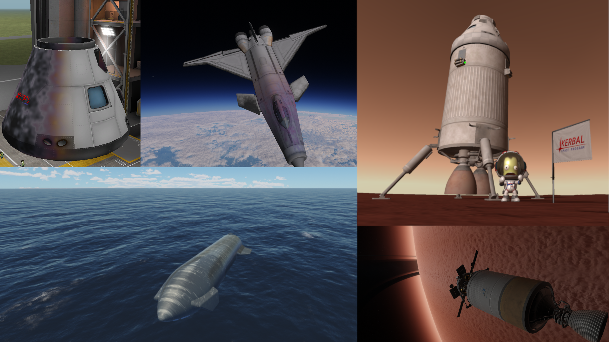

# Losket

Losket marks your craft with the flights it has been through. Re-entry scorches
the surfaces that took the heat, engine exhaust blackens whatever stands in its
way, and engines and rotors coat the hull in dust the colour of whatever you
landed on. All of it accumulates over a vessel's lifetime and is saved with it.




## Requirements

- KSP 1.12.0 to 1.12.5
- ModuleManager

## Installation

Copy the `GameData/Losket` folder from the release archive into your KSP
`GameData` folder. To uninstall, delete that folder. Craft that were scorched
will simply load clean.

## Usage

Losket adds a toolbar button in the space centre, the editor and in flight. It
opens a small window with the global defaults. The same options also live in
Settings > Difficulty > Losket.

Everything else is per part, in the editor. Right-click a part and look for the
Losket group:

- Affected by — Nothing, Scorching, Dust, or Scorching and dust. Parts you will
  never see, or that sit inside a fairing, can be set to Nothing to save the
  work of rendering them.
- Preset — the look of the deposit. Soot is matte black with soft edges. Metal
  is lighter, sharper, and shows the full blue heat tint. Streaks is bleached
  and elongated, closer to how Starship comes back.
- Advanced settings — opens a window with the individual sliders: deposit
  colour, heat tint, bleaching, sharpness, pattern scale, streak length, a
  blend between blotches and streaks, and a Reflections switch (see
  [Reflective surfaces](#reflective-surfaces)). Touching any slider switches
  the preset to Custom.
- Preview scorching — shows the effect in the editor without flying.
- Exhaust: scorching / no heat — on engine parts only. Propellers, turboprops
  and lift fans are guessed from their part name and start as "no heat", so
  their wash leaves no soot or heat tint on the fuselage; jets and rockets
  start as "scorching". Click to override either way. Modders can also set
  `exhaustHeat = hot` or `cold` on the ModuleLosketExhaust module.

In flight the same group reports how much scorching and dust the part has
accumulated, as a percentage.

Defaults apply to newly placed parts only. Changing them does not touch parts
that are already on the craft.

## Dust colour

Dust takes the colour of the ground below the vessel, from a table in
`GameData/Losket/Configs/dust-colors.cfg` rather than by sampling the terrain. All
stock bodies are covered. Bodies with no entry fall back to a neutral grey-brown.

Planet packs can add their own bodies with a ModuleManager patch:

```
LOSKET_BODY_DUST { body = MyBody  color = 0.5, 0.4, 0.3 }
```

How the dust lands depends on the atmosphere. In thick atmosphere it swirls
and settles from every direction; in thin air it is thrown further and hits the
sides of the craft. Engines fired over water, launchpads, runways and other
built surfaces raise nothing.

Dust is off in vacuum by default: the effect works but did not look convincing
in play. Tick **Dust in vacuum** in the Losket settings to raise dust on the Mun
and Minmus too. With the box unticked, the pressure threshold in
`GameData/Losket/Configs/losket-settings.cfg` (`dustMinPressureAtm`) applies.

### Dust storms (Volumetric Clouds)

With Blackrack's Volumetric Clouds installed, a vessel caught in one of Duna's
dust storms slowly gets covered in Duna dust, from above: landed, flying or
under time warp. A full storm covers a part in about two game hours. Losket
only reads the storm coverage the clouds mod already computes; without it,
nothing changes. A cloud layer counts as a storm when its name contains
"dust", so planet packs that follow the same naming work too. Duna's thin
scattered dust hazes deposit five times less than its big storms; each layer's
weight is a `LOSKET_STORM_LAYER` node that planet packs can add with a
ModuleManager patch. The settings (`stormDust`, `stormLayerKeyword`,
`stormCoverageMin`, `stormCoverageMax`, `stormDustTime`) live in
`GameData/Losket/Configs/losket-settings.cfg`.

### Dusty solar panels

Dust shades solar panels. A panel's output drops in proportion to its dust
cover. The **Solar power lost under full dust** slider in the Losket settings
sets the loss at full cover and follows the difficulty preset: Easy 0% (no
effect), Normal 50%, Moderate 70%, Hard 100%. On Normal, a panel under a full
layer of dust produces half its clean output, a half-covered one 75%. The part
menu's energy flow shows the reduced figure. Water,
fast flight and an engineer's cleaning restore the output along with the
finish. A panel that collected its dust while folded keeps its full output:
the dust is on the housing, the cells stayed clean, and that is also how it is
drawn.

With Kopernicus installed, panels are powered by Kopernicus itself and dust
does not affect them.

## Engine exhaust

Anything that sits in an engine's exhaust gets marked: the stage below during a
hot staging, a tank licked by a separation motor, another vessel parked behind
a running engine. The mark is a patch of soot ringed with heat tint, centred
where the jet hit and drawn out downstream. Parts of the engine's own vessel
are marked like any other.

The exhaust is a cone behind each nozzle. Thrust sets its size, not its
strength: a Sepatron burns as hard as a Mainsail at the nozzle, it just does
not reach as far. In vacuum the cone flares wide and thins out quickly; in
thick atmosphere it stays narrow and carries further. Parts, terrain and
buildings standing in the way shield what is behind them.

Nozzles also mark themselves, slowly. Engines are built for heat and mark ten
times slower than other parts: the heat tint fades in over a minute or so of
running, with only a little soot.

Jet engines (anything that breathes `IntakeAir`) mark other parts ten times
slower than rockets: their exhaust is far cooler and burns clean, so a fuselage
behind a jet only darkens after long flights. The jet's own nozzle still tints
as usual. Modders can change the factor with `airBreathingRate` on
ModuleLosketExhaust (default 0.1).

Ion engines leave nothing. Exhaust marks follow the **Scorching** choice of
each part, and the Losket settings have a switch to turn them off altogether
and a rate slider from x0.1 to x10.

## Deployable parts

What was folded away when the marks landed comes out clean. A solar panel
stowed in its housing during re-entry unfolds unmarked, and so do antennas,
radiators and parachute canopies. The housing itself keeps its marks.

This covers parts whose deployment KSP tracks itself: solar panels, antennas,
radiators and parachutes. If such a part picks up any marks while deployed, it
is marked as a whole from then on, until it is cleaned.

## Cleaning a part

An engineer on EVA gets a **Clean part** button in the part menu of any part
that carries scorching, exhaust marks or dust, as long as the kerbal is within a few metres of
the part's surface. Recovering a vessel also cleans it.

Water washes dust off (scorching stays). A part sitting still in the water
loses its dust slowly; the faster it moves through the water, the faster it
comes clean, so a boat under way or a propeller spinning underwater is clean
within seconds. Parts inside a fairing or a closed cargo bay stay dry. The
rates are `soakTime` and `washLength` on `ModuleLosketDust`, for
ModuleManager patches.

Fast flight through thick air blows dust off too. Below about 10 kPa of dynamic
pressure (130 m/s at Kerbin sea level) dust stays put, so rovers and powered
landings keep theirs; above it, the dust thins out over time, faster the harder
the air hits: about a minute per step at 20 kPa, twenty seconds through a
rocket's max-Q. A dusty plane comes back clean after a few minutes at speed.
Duna's air is too thin to clean anything. The rates are `airMinQ` and
`airTime` on `ModuleLosketDust`.

## Dust rate

The Losket settings (toolbar button, or Difficulty > Losket) have a **Dust
rate** slider from x0.1 to x10. It scales how fast dust settles at the moment
it lands; dust already on a part is not changed.

## Reflective surfaces

Soot and dust are matte. A layer of either takes away the reflections of the
surface underneath in proportion to how much of it the layer covers: a
half-covered panel keeps half of its shine, a fully covered one keeps none.
A heat tint is different. It is a thin film of oxide on polished metal, so a
blued surface keeps its mirror finish and reflects with a blue cast.

The **Reflections** switch in a part's advanced settings says how its
scorching behaves. *Dimmed* (the Soot and Streaks presets) treats the deposit
as soot. *Kept* (the Metal preset) colours the surface without taking its
shine away, for stainless steel and other bare metal that comes back
discoloured but still bright. Dust is always matte, and the heat tint never
is. Exhaust marks follow the switch of the part they land on.

With Deferred installed, Losket writes its marks into the G-buffer, so the
gloss of the surface is reduced before it is lit: reflections from Deferred's
probes and screen-space reflections, TexturesUnlimited metals and ShineFix
finishes all fade under the dust, and the part keeps its normal map and its
shadows under the soot. This needs the part's own shader to render in
deferred too: parts drawn by a forward-only shader, such as TexturesUnlimited
before 1.6.0.26 (the version Deferred itself requires), keep the blended
overlay described next. Without Deferred the marks are blended over the lit
image, so a reflection can only be hidden by covering it: a full matte layer
is opaque, a partial one lets the reflection through in proportion, and a
*Kept* deposit stays slightly see-through so the shine below shows.

## Compatibility

Tested against Deferred, Restock, TURD and TexturesUnlimited (version 1.6.0.26 and later for better behavior), ShineFix, and
against modded parts.

## Languages

English, French and Simplified Chinese. Adding a language means duplicating a
block in `GameData/Losket/Localization/losket.cfg` and translating it; no code
changes are involved.

## Building from source

See [docs/DEVELOPMENT.md](docs/DEVELOPMENT.md)
