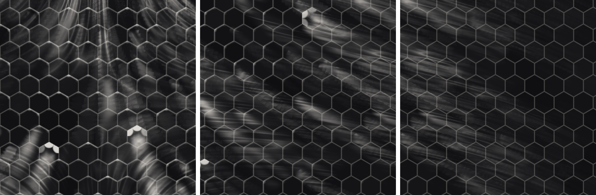

# Traces blanches du Starship : physique réelle et nouveau système proposé

Ce document répond à une question précise : d'où viennent les traces blanches
que le vrai Starship ramène de sa rentrée, et comment Losket pourrait les
produire avec un système dédié, à côté du motif « Stries » actuel, sans le
remplacer.

Il y a trois parties : ce que disent les sources sur le vrai véhicule, ce que
fait Losket aujourd'hui et pourquoi ça diverge de près, puis le système
proposé avec son prototype hors jeu (`Tools/render_tiles.py`).

## 1. Ce qui se passe sur le vrai Starship

### 1.1 L'empilement du bouclier

- Environ 18 000 tuiles hexagonales noires sur la face au vent, données pour
  1 400 °C. Composition non publiée, « probablement silice, alumino‑borosilicate
  et alumine » ; des tuiles de silice frittée proches des LI‑900 de la navette
  (90 % de vide) avec un revêtement vitreux noir en coquille mince. Point
  important pour nous : **sous le revêtement noir, la tuile est blanche**
  (navette : « uncoated tiles are bright white »).
- Chaque tuile est tenue par des ergots, sur un matelas de feutre. Depuis le
  vol 4 (juin 2024) une **couche ablative secondaire** est posée sous les
  tuiles ; matériau non divulgué (Wikipedia suppose du Pyron). Si une tuile
  part, cette couche carbonise et protège l'inox.
- Entre les tuiles, des **interstices** laissés pour la dilatation. Après le
  vol 10 (août 2025), SpaceX a ajouté le « crunch wrap » : du feutre enroulé
  autour des bords de chaque tuile et comprimé entre voisines pour boucher les
  joints, parce que des « taches blanches » étaient apparues là où la chaleur
  s'était glissée entre les tuiles et avait brûlé le matériau dessous.
- Face sous le vent, volets et jupe : inox 304L nu, ou protections ablatives
  autour des charnières.

### 1.2 Les quatre phénomènes qui marquent la surface

**A. Fuite de plasma par les joints, dépôt blanc en aval.** C'est le
phénomène principal derrière les traînées blanches, et celui que vous
pressentiez.

- Trois anciens de la NASA (Rasky, Camarda, Miller) ont analysé les images
  drone après le vol 13 (juillet 2026) : les traînées blanches « semblent
  partir des frontières entre tuiles », avec des tuiles fissurées et des bords
  cassés ; elles trahissent du gaz chaud passé dans les interstices.
- Ryan Hansen Space : « les traînées blanches sont des dépôts du matériau
  ablatif placé sous les tuiles » ; le plasma chauffe l'ablatif exposé, qui
  brûle et dépose sur les tuiles voisines ; « les dépôts indiquent des tuiles
  cassées à l'endroit d'où partent les traînées » (coins manquants visibles
  dans la vidéo drone).
- Après immersion des volets dans la mer, « une bonne partie de la poudre
  part ». C'est donc un **dépôt pulvérulent posé sur la tuile**, pas une
  altération de la tuile : les tuiles dessous sont restées noires.
- Côté navette, l'étude des interstices confirme le mécanisme : chauffe
  excessive dans les joints de tuiles en marche d'escalier, décoloration et
  carbonisation de la barre de remplissage et du SIP ; un gap filler qui
  dépasse de moins de 3 cm déclenche la turbulence et augmente la chauffe en
  aval d'environ 25 % (STS‑114).

Ce qui est blanc, précisément, n'est tranché par aucune source : silice du
feutre ou de la tuile, ou résidu de pyrolyse de l'ablatif. Pour le rendu ça ne
change rien : une poudre blanche mate, posée en aval d'un point de fuite.

**B. Érosion du revêtement au bord et à la pointe amont des tuiles.**
« L'érosion de la pointe d'attaque des hexagones » est décrite comme une
observation constante ; après le vol 13, des coins de tuiles manquent. Le
revêtement noir est une coquille mince sur une tuile blanche : là où il part,
la tuile blanchit. Même mécanisme que STS‑27 en 1988, où le revêtement arraché
par un impact avait laissé des traînées blanches sur le fuselage. Sur la photo
de référence, c'est ce qui dessine le **liseré clair autour des hexagones**,
avec les joints eux‑mêmes (feutre ou crunch wrap plus clairs que la tuile).

**C. Tuiles cassées ou manquantes.** Tache blanche (feutre ou ablatif exposé,
charbonné au centre), et surtout **source forte de dépôt en aval** : ce sont
elles qui font les grands éventails de la photo. Attention : au vol 13, des
tuiles ont été **peintes en blanc exprès** pour servir de cibles aux caméras
des Starlink V3, et au vol 10 des tuiles métalliques expérimentales ont rouillé
(traînées orange). Ne pas copier ces deux‑là.

**D. L'inox nu.** Revenu (teintes d'oxyde, paille → brun → bleu → gris),
« acier décoloré », « marques de chauffe ». Losket a déjà la LUT de revenu pour
ça. Ce qu'il n'a pas : le dépôt blanc **déborde de la zone tuilée** sur l'inox
en aval (bord sous le vent, volets, jupe), en traînées axiales pâles, comme sur
la photo « After ».

### 1.3 Dans quel sens vont les traînées

Le Starship rentre ventre en avant, à forte incidence. En impact newtonien, le
gaz qui frappe la paroi garde sa composante tangentielle : **la ligne de
courant de surface est la projection du vent relatif sur la paroi**. Pour un
cylindre d'axe `z` à incidence `α`, avec `θ` compté depuis la ligne au vent :

- composante axiale ∝ `cos α`, vers l'arrière ;
- composante circonférentielle ∝ `sin α · sin θ`, qui **s'écarte de la ligne
  au vent** vers les flancs.

Conséquence : sur la ligne au vent les traînées sont axiales ; sur les flancs
elles tournent autour de la coque et finissent sur l'inox sous le vent. Les
essais NASA de visualisation pariétale (huile) sur cylindre en incidence
montrent exactement ces lignes. Une traînée part d'un point, **s'élargit en
éventail** de quelques degrés, **s'atténue** sur un à deux mètres, et
**traverse les tuiles** sans s'interrompre aux joints. Sa texture est
**filamentaire** : la poudre voyage en filets dans la couche limite.

## 2. Ce que fait Losket aujourd'hui, et l'écart

Le motif « Stries » (`_Pattern = 1` dans `LosketBurnOverlay.cginc`) est un
bruit de filaments continu, évalué partout, aligné sur la carte `(h, w)`
autour de la ligne de stagnation, avec des grappes de densité le long de la
colonne et une dérive aval fixe (`_SlantAft`). C'est ce qui donne les captures
1 et 2 : de loin, des rayures longues et nettes alignées sur l'axe, ça passe.

De près, cinq écarts avec le vrai véhicule :

1. **Pas d'origine.** Une vraie traînée part d'un joint ou d'un coin cassé,
   s'élargit et s'éteint. Le bruit continu n'a ni début, ni éventail, ni
   décroissance : il fait des rayures de longueur uniforme.
2. **Rayures nettes au lieu de poudre.** Les filaments du bruit sont fins et
   tranchés comme des griffures ; la vraie trace est un voile diffus de
   filets, dense près de la source et de plus en plus ténu.
3. **Rien ne suit les tuiles.** Aucun liseré de bord, aucune pointe amont
   blanchie, aucune tuile cassée.
4. **Répartition uniforme.** Le bruit couvre la pièce de façon homogène. En
   vrai, peu de joints fuient, mais ceux qui fuient fuient fort.
5. **Direction.** La carte actuelle tourne autour d'un axe rendu
   perpendiculaire au flux, avec une dérive aval constante. Sur un cylindre en
   incidence, le courant est axial au centre et circonférentiel sur les
   flancs : la dérive devrait dépendre de `θ`.

## 3. Première version : motif « Tuiles » sur une carte cylindrique (abandonnée)

> Cette section décrit la première implémentation, testée en jeu le
> 2026‑11‑05 et remplacée le soir même par la méthode par la texture de la
> section 6. Elle reste ici pour la physique et les réglages, qui n'ont pas
> changé, et pour les leçons (crénelage, scintillement). Les sous‑sections
> sur la carte, l'écoulement cylindrique et la grille hexagonale ne
> correspondent plus au code.

Un troisième motif, à côté de « Taches » et « Stries », avec un préréglage
« Tuiles » (ou « Starship »). Rien de l'existant ne change : même overlay, même
espace motif, même accumulation de dose, même LUT de revenu, même passe
différée. Seul le calcul de `grime` a une branche de plus.

### 3.1 Carte de surface

Tout se calcule en espace motif, comme aujourd'hui.

- **Axe de coque** `_HullAxisO` : la plus grande dimension du maillage
  (`LongestAxis`, déjà calculé par le rig), **sans** lui retirer sa composante
  le long du flux. Un repère perpendiculaire fixe `_HullRefO` sert d'origine
  angulaire à la grille (pris sur les axes de l'espace motif, pas sur le flux :
  la grille ne doit pas tourner quand la direction accumulée bouge).
- Par pixel : `h = dot(sPos, axe)`, `rp = sPos − axe·h`, `θ = atan2(…)`, et
  la **carte** `c = (R₀·θ, h)` avec `R₀` le rayon moyen de la pièce passé par
  le C# (demi‑extensions des deux autres axes de la boîte) pour le mode, et
  le **rayon local du pixel** pour l'arc : un `R₀` constant étirait les
  tuiles vers la pointe du nez (vu en jeu le 2026‑11‑05). Avec l'arc réel,
  chaque rangée garde des tuiles à la bonne taille et les rangées glissent
  l'une sur l'autre, comme sur un vrai nez tuilé ; sous un pas de tuile de
  rayon, plus de sources ni d'usure, la carte s'y referme.
- La seconde coordonnée n'est pas la hauteur le long de l'axe mais
  l'**abscisse le long du méridien** : sur l'ogive du nez, la pente allonge
  la surface et des tuiles posées sur la hauteur s'étiraient en traits (vu
  en jeu le 2026‑11‑05). Le rig relève le profil de la pièce sur son
  maillage (`HullArcProfile` : 16 tranches le long de l'axe, rayon maximal
  par tranche, arc cumulé aux frontières) et le passe au shader, qui
  interpole. Sur un cylindre l'arc vaut la hauteur, rien ne change et les
  pièces empilées gardent leurs rangées communes ; maillage illisible :
  profil linéaire.
- La carte est **calculée une fois par overlay** et figée (refaite seulement
  si le repère motif change). Recalculée à chaque image depuis les matrices
  monde, ses choix discrets basculaient sur le bruit flottant : pour un
  réservoir d'axe vertical, les composantes x et z de l'axe sont du pur
  bruit, le repère angulaire changeait d'une image à l'autre et la grille
  sautait d'un quart de tour, les marques clignotaient (deuxième
  enregistrement du joueur, 2026‑11‑05). Le repère est aussi choisi sans
  égalité possible : x si l'axe est à moins de 60° de la verticale, y sinon.
- **Pièces plates** (volets, ailes) : carte dans le plan de la pièce (axe le
  plus long, puis le moyen). Le C# choisit par pièce (`_ChartMode`,
  `LosketOverlayRig.HullChart`) : plaque quand la plus petite extension de
  la boîte fait moins du quart de la moyenne, sinon cylindre autour de l'axe
  dont les deux autres extensions se ressemblent le plus (un réservoir
  court et large garde ainsi son axe de révolution).

### 3.2 Écoulement de surface

- `dl` est la direction du flux en espace motif (`_BurnDirO`, inchangé).
- Flux quasi axial (nez en avant, aperçu de l'éditeur) : il n'y a pas de
  ligne au vent, la chauffe relative `cos(θ − θ_w)` valait 0 partout et
  rien ne se déposait (l'aperçu du VAB ne montrait que le revenu). La
  chauffe et le secteur fondent vers 1 quand la composante du flux
  perpendiculaire à l'axe passe sous 0,35.
- Carte cylindre : à l'angle `θ`, normale radiale `n_r`, tangente
  `t = dl − n_r·dot(dl, n_r)`, vitesse dans la carte
  `v = (dot(t, e_θ), dot(t, axe))` avec `e_θ = cross(axe, n_r)`. Tout est
  analytique : la marche amont (3.4) **recalcule la direction à chaque pas**,
  ce qui donne les vraies lignes de courant courbes sur les flancs.
- Carte plate : `t = dl − n·dot(dl, n)` avec la normale du pixel, constante le
  long de la marche.

### 3.3 Sources (champ `S`, évaluable en tout point de la carte)

- **Grille hexagonale** de pas `_TileSize` (m), orientation `_TileRot`
  (rangées autour de la coque ou le long de l'axe), par la fonction classique à
  deux grilles décalées : vecteur au centre `gv`, distance au bord, normale du
  bord le plus proche, sommet le plus proche. Une trentaine d'opérations.
- **Joint** : bande lissée (demi‑largeur ≈ 0,25 pas, volontairement plus large
  que le pas de marche, sinon la traînée se crénelle) × **exposition**
  `|dot(v, n_bord)|` (un joint transversal au courant reçoit le gaz, un joint
  parallèle non ; c'est le « pas de chemin droit pour le gaz » des hexagones) ×
  **fuite** tirée au sort par joint (hash du milieu du bord, commun aux deux
  tuiles) et seuillée : `_LeakFrac` ≈ 5–8 % des joints fuient. Passé à 12 % par défaut après validation en jeu : le joueur
  voulait un peu plus de traînées.
- **Coin** : disque ≈ 0,25 pas autour du sommet, hash du sommet (commun aux
  trois tuiles), gain ×3 ; la part de coins qui fuient vaut 0,7 × celle des
  joints, pas de curseur à part. Les **deux** sommets du bord le plus proche
  sont évalués, chacun avec sa fuite : n'évaluer que le plus proche
  tronquait son disque là où l'autre devient plus proche, et cette arête
  dure, échantillonnée au pas de marche, faisait des barreaux le long des
  panaches.
- **Tuile cassée** : `hash(centre) > 1 − _BrokenFrac` (défaut ≈ 1 %), la
  tuile entière comme source, fondue à zéro sur son bord (distance
  hexagonale) et plus forte vers l'amont, gain ×2. La tuile montre aussi
  son coin blanc (3.6) : un seul, celui qui pointe le plus vers l'amont.
- Le tout × la **chauffe locale** (le masque directionnel existant : `facing`
  et le gradient `proj`), pour que rien ne fuie à l'abri, et × un **secteur
  tuilé** `_TiledHalfAngle` autour de la direction au vent capturée au premier
  vol, pour que les sources n'existent que là où il y a des tuiles. À 180° toute
  la pièce est tuilée ; une pièce d'inox nu garde le préréglage Métal.

### 3.4 Transport (la nouveauté)

Le dépôt en un pixel est la somme de ce que les sources **amont** ont lâché :

```
D(P) = Σ_k  moyenne_latérale( S(P_k) ) · exp(−s_k / _Decay) · ds
P_0 = P − v(P)·ds·jitter ;  P_{k+1} = P_k − v(P_k)·ds
```

- `N = 16` pas dans le shader (24 dans le prototype), `ds = _StreakLength / N`
  (défaut 1,5 m en jeu, 1,8 m dans le prototype à l'échelle réelle).
  L'atténuation `_Decay` vaut 0,75 × la portée, pas de curseur à part.
- **Décalage du premier pas par un bruit lisse** (période ≈ 10 cm) : il
  désynchronise les marches d'un pixel à l'autre sans crénelage. La
  première version utilisait un hash par pixel, un bruit blanc à l'échelle
  sous‑pixel : en jeu, dès que la caméra bouge d'un millimètre le point de
  surface sous le pixel change et le tirage se refait, tout le dépôt
  scintillait (enregistrement du joueur du 2026‑11‑05).
- **Bandes de source calées sur le pas de marche**, hauteur réduite d'autant
  pour que la dose intégrée ne change pas. Mesuré hors jeu en sommant une
  bande prélevée à pas constant à toutes les phases : une bande smoothstep
  de demi‑largeur égale au pas se somme à une constante (1,2 pas donnait
  ±4 %, des barreaux le long des panaches) ; un disque demande 1,5 pas, un
  disque à plateau (coin cassé) 2 pas. L'empreinte d'un pixel (`fwidth`)
  élargit encore les bandes à distance.
- **Éventail** : trois prélèvements à chaque pas, au centre et à
  `± s_k·tan(_FanAngle)` (≈ 6°) perpendiculairement au courant, moyennés : la
  poudre se dilue en s'écartant.
- Coût : 36 évaluations de `S` par pixel, quelques centaines d'opérations, du
  même ordre que les trois octaves de bruit déformé du motif Taches. Un
  réglage bas à 8 pas et 2 prélèvements reste possible.

### 3.5 Filaments

Le bruit de crêtes du motif Stries, mais dans la carte et aligné sur la
**direction locale** du courant : coordonnées `(travers × 7·échelle/m,
long × 0,45·échelle/m)`, soit des filets de 3‑4 cm au réglage par défaut.
Quand leur période tombe sous trois pixels (`fwidth`), ils fondent vers
leur moyenne au lieu de fourmiller, l'octave fine la première. Le dépôt
visible vaut `D × (0,15 + 0,85·fil)` : des faisceaux de filets, denses à la
source, de plus en plus clairsemés.

### 3.6 Usure de bord

Au pixel lui‑même, sans transport : bord de tuile qui **fait face au courant**
(`dot(n_bord, −v) > 0,3`) → bande de 0,09 pas × chauffe² × variation par tuile
(hash) ; **pointe amont** (`dot(sommet, −v) > 0,55`) → disque de 0,17 pas ×
chauffe². Tuile cassée → coin manquant blanc. Gain global `_EdgeWear`. Un
liseré n'est jamais plus fin qu'un pixel et demi : sa largeur suit
l'empreinte du pixel et son intensité baisse d'autant, sinon il fourmille
à distance.

### 3.7 Composition

```
blanc = 1 − exp(−2,5 · (D·(0,15 + 0,85·fil) + _EdgeWear·E))
```

alimente le chemin `soot` existant avec `_Bleach = 1` (dépôt
(0,92, 0,90, 0,87)) et `_Matte = 1` (poudre mate, elle éteint le reflet). La
LUT de revenu reste telle quelle, mais le revenu est **coupé dans le secteur
tuilé** : la céramique ne bleuit pas, seul l'inox hors des tuiles se teinte
(dans l'aperçu du VAB, où le flux est axial et le secteur complet, plus de
voile brun sur le nez). Une pièce d'inox garde le préréglage Métal, et le
dépôt blanc qui déborde de la zone tuilée s'y pose par‑dessus le revenu,
pâle, comme en vrai. Sur une texture de tuiles sombres le même dépôt ressort
très blanc : c'est la texture de base qui fait la différence, pas le shader.

Tout est en espace motif : continu entre pièces voisines si elles partagent le
pas de tuile et le secteur, figé avec le repère capturé, insensible au
Krakensbane, et `_BurnMag` (la dose) met à l'échelle `D` et `E` comme
aujourd'hui.

### 3.8 Intégration C#

- `BurnParams` : `TileSize`, `TileRot`, `TileLeak`, `TileBroken`,
  `TileLength`, `TileFan`, `TileEdgeWear`, `TileSector` ; le rig calcule
  axe, repère angulaire, centre, rayon et mode de carte de chaque maillage
  (`LosketOverlayRig.HullChart`) et pousse le tout au shader à côté de la
  colonne actuelle.
- Préréglage « Tuiles » dans `LosketKeys` et `ModuleLosketBurn.ApplyPreset`
  (`pattern = 2`, `bleach = 1`, `matte = true`), champs persistants
  `tile*` sur le module, curseurs dans `LosketStyleWindow` visibles quand
  le motif Tuiles est choisi (pas des tuiles, joints qui fuient, tuiles
  cassées, portée, éventail, usure des bords, secteur tuilé, rangées),
  localisation en/fr/zh, sérialisation dans `LosketUserPresets`.
- `Tools/render_tiles.py` porte les maths comme `render_pattern.py` porte le
  motif Taches : toute modification du shader s'y reporte.

### 3.9 Limites et choix ouverts

- **Grille et texture.** La grille procédurale ne tombe pas sur les hexagones
  de la texture SEP (confirmé en jeu le 2026‑11‑05 : les coins cassés
  tombent entre deux tuiles peintes). Invisible à la distance de la capture 2, visible au ras
  de la coque (capture 1) : un liseré blanc à cheval sur deux hexagones de la
  texture. Deux pistes pour une phase 2 : relever les joints dans la texture de
  base (détection de contours, cuite une fois par pièce dans une petite
  texture), ou laisser une patch ModuleManager déclarer le pas et le décalage
  de la grille d'une pièce connue.
- **Cônes** : `R₀` constant étire les tuiles vers la pointe.
- **Continuité entre pièces** : les sources d'une pièce voisine ne nourrissent
  le dépôt de celle‑ci que si les deux ont le même pas et le même secteur. Le
  C# pourrait synchroniser `R₀` et le secteur à l'échelle du vaisseau comme il
  fige déjà la fenêtre de motif.
- **Volets** : carte plate, pas de panache de charnière.

## 4. Prototype hors jeu

```bash
python Tools/render_tiles.py out
```

Écrit `tuiles.png` (trois positions sur la même coque : ligne au vent, flanc à
45°, flanc à 75°, même réglage) et `tuiles-couches.png` (dépôt seul, usure de
bord seule). Coque de 4,5 m de rayon, incidence 65°, tuiles de 30 cm, fenêtre
de 3 m : échelle réelle, pour comparer à la photo.



Ce qu'on y voit : des éventails qui partent de coins et de tuiles cassées,
axiaux au centre, obliques à 45°, presque circonférentiels à 75° ; des
faisceaux de filets qui traversent les tuiles et se raréfient en s'éloignant
de la source ; le liseré amont des hexagones (`prototype-tuiles-couches.png`
l'isole, à droite). Deux défauts connus : le grain du décalage aléatoire est
visible près des sources (un second décalage par prélèvement latéral, ou plus
de pas, le lisse), et le voile diffus en haut de la vue au vent vient de
sources hors cadre, ce qui est voulu mais sera à doser par `_Decay`. Ce qui
reste à régler en jeu, sur le SEP : la part de joints qui fuient, l'angle
d'éventail, l'échelle des filaments et le pas de tuile face à la texture.

Le premier rendu, sans décalage aléatoire et avec des bandes de source fines,
montrait des traînées en échelle : chaque marche tombait ou non sur le joint
selon le pixel. C'est pour ça que les bandes font 0,25 pas et que le premier
pas est décalé.

## 5. Plan d'implémentation

1. **Shader** (fait le 2026-11-05) : bloc « Motif Tuiles » dans
   `LosketBurnOverlay.cginc` (`TileGrime()` et ses fonctions), branché sur
   `_Pattern > 1.5`, nouvelles propriétés dans les deux `.shader`, passe
   avant passée en `target 3.0` pour la boucle de transport ; bundle
   recompilé en ligne de commande (`docs/DEVELOPMENT.md`). « Stries » intact.
2. **C#** (fait le 2026-11-05) : paramètres, rig, préréglage, fenêtre,
   localisation, presets utilisateur, aperçu de développement.
3. **Validation en jeu** sur le Starship SEP : coque en « Tuiles », volets en
   « Tuiles » (carte plate), inox sous le vent en « Métal » ; captures à
   comparer avec la photo 3 ; réglage des défauts (pas des tuiles face à la
   texture, secteur tuilé, portée à l'échelle KSP).
4. **Phase 2** si le ras de coque le demande : joints relevés dans la texture.

## 6. Méthode par la texture (implémentée le 2026‑11‑05, version en service)

Code : bloc « Motif Tuiles » de `LosketBurnOverlay.cginc` (`TileBuildFrame`,
`TileSources`, `TileDeposit`, `TileFilaments`, `TileWear`, `TileGrime`),
shader de blit `Losket/SeamMap`, cache `LosketOverlayRig.SeamMapFor`. Les
réglages par pièce restants : taille des tuiles (cellules du tirage des
fuites), joints qui fuient, tuiles cassées, portée, éventail, usure des
bords. Le prototype `Tools/render_tiles.py` modélise toujours la version
cylindrique : il sert pour la physique du transport, pas pour le shader.

Les essais en jeu montrent la limite de toute **carte** : projeter la surface
sur un cylindre, même avec le rayon local et le profil du maillage, déforme
dès que la pièce n'est pas un cylindre parfait. Sur le nez les tuiles
s'étirent ; sur la coque, le profil relevé par rayon maximal est trompé par
les charnières et capots inclus dans le même maillage, et les tuiles s'y
aplatissent. Et la grille reste étrangère aux hexagones peints.

La méthode qui marche « par sa logique même » : **les tuiles sont là où la
texture les dessine**. L'artiste de la pièce a déjà posé les hexagones sans
déformation dans l'espace UV ; il suffit d'y lire les joints et d'y faire le
transport.

- **Carte de joints cuite depuis la texture de base.** Une fois par texture,
  un petit shader de blit (`Losket/SeamMap`) applique un **détecteur de
  lignes** à la luminance de la texture de base dans une RenderTexture
  (moitié de la taille, R8, avec mipmaps) : dans douze directions, la
  réponse en travers `|c − (a + b)/2|`, avec `a` et `b` à deux texels de
  part et d'autre, doit se maintenir le long de la ligne (minimum sur 0, ±3
  et ±6 texels, avec une tolérance d'un texel en travers aux positions
  décalées, sinon les arêtes à 30° entre deux directions se perdent), et la
  carte garde le maximum sur les directions. Une ligne longue
  passe, un point, un grain ou un tiret court tombent. Un simple passe‑haut
  prenait le grain de rivets de la texture d'inox SEP pour des joints (taches
  blanches sur la coque, premier essai), et un détecteur à courte portée ses
  tirets de 2×4 texels ; mesuré hors jeu sur les textures SEP : avec les
  seuils 0,08 et 0,20, la coque n'a plus que ses soudures et les tuiles
  gardent 84 % de leurs contours (32 % sans la tolérance). Les interstices, clairs ou sombres, ressortent ; une
  texture d'inox nu donne une carte presque vide, donc **pas de tuiles sur
  l'inox, sans secteur tuilé ni réglage**. Les lignes de panneaux et de
  soudure ressortent aussi, et en vrai elles fuient aussi.
- **Ce que SEP fait vraiment** (mesuré le 2026‑11‑05) : les tuiles sont une
  texture **répétée** à part, `SEP_B3_TILES_BASE`, 4096², hexagones de
  51 texels, joints clairs de 1 à 2 texels, portée par un maillage séparé de
  la coque ; la coque d'inox a ses propres textures `SEP_B3_Ship_Core_N_BASE`
  (4096², une par variante), dépliée en un seul rectangle continu, avec un
  grain fin de rivets. Chaque renderer reçoit son overlay et sa carte ; la
  répétition de la texture des tuiles rend la marche en UV continue.
- **Transport en espace UV.** La base tangente du triangle sous le pixel
  vient des dérivées d'écran (`ddx`/`ddy` de la position monde et des UV) :
  `T = ∂pos/∂u`, `B = ∂pos/∂v`, exactes par triangle, sans tangentes de
  maillage ni réglage de densité. La direction du courant de surface (composante
  tangentielle du vent) se projette sur `(T, B)` en coordonnées UV, un pas
  de `ds` mètres devient un pas UV, et la marche amont échantillonne la carte
  de joints (`tex2Dlod`, niveau de mip pris sur l'empreinte du pixel : le
  lissage à distance vient gratuitement des mipmaps). Les filaments restent
  calculés dans le plan tangent en mètres.
- **Usure de bord sans grille.** Le bord amont d'une tuile est le côté aval
  d'un joint : `carte(uv − v·δ) − carte(uv + v·δ)`, positif seulement là, à
  moduler par l'exposition du joint au courant.
- **Fuites et tuiles cassées.** Plus d'identité de joint ; un champ aléatoire
  en cellules de **32 texels de la carte** (mises à l'échelle par le curseur
  de taille des tuiles) choisit les zones qui fuient et les tuiles cassées
  (lisère épais sur la carte de joints, source forte). Les cellules sont
  en texels et non en mètres : calculées depuis la densité de texels propre
  à chaque triangle, elles sautaient d'un triangle à l'autre sur le nez et
  dessinaient des rangées de triangles (premier essai).

Ce qui a disparu : la carte cylindrique, `HullChart`, le profil de coque,
l'orientation des rangées et le secteur tuilé. Ce qui reste : la taille des
tuiles (pour les cellules du tirage), la portée, l'éventail, la part de
joints qui fuient et de tuiles cassées, l'usure des bords. Le revenu est
coupé là où la densité de joints (carte lue à un niveau de mip grossier)
est forte : la céramique ne bleuit pas, l'inox nu si.

Limites à accepter : aux coutures UV, la marche lit l'île voisine sur une
portée au plus (traînées coupées sur une bande d'un mètre et demi) ; la marche
est droite en UV, sans la courbure des lignes de courant autour de la coque
sur cette portée ; la texture de base doit porter les interstices (SEP oui ;
un matériau TexturesUnlimited dont la texture principale est un masque ne
donnera rien) ; une RenderTexture par matériau tuilé, de l'ordre du mégaoctet.
Coût estimé : un shader de blit dans le bundle, environ 250 lignes de shader
et 120 lignes de C#.

## 7. Sources

- [Gizmodo, Starship's heat shield looked great after Flight 13, but experts spotted something troubling](https://gizmodo.com/starships-heat-shield-looked-great-after-flight-13-but-experts-spotted-something-troubling-2000791792)
- [NextBigFuture, SpaceX Starship heat shield analysis (Ryan Hansen Space)](https://www.nextbigfuture.com/2026/07/spacex-starship-heat-shield-analysis.html)
- [NextBigFuture, Seawater washed Starship's flaps clean, and the tiles underneath are black](https://www.nextbigfuture.com/2026/07/seawater-washed-starships-flaps-clean-and-the-tiles-underneath-are-black.html)
- [TechTimes, Starship heat shield tiles are a dead end for rapid reuse, former NASA experts warn](https://www.techtimes.com/articles/322079/20260729/starship-heat-shield-tiles-are-dead-end-rapid-reuse-former-nasa-experts-warn.htm)
- [Nature World News, Starship heat shield faces major reuse challenge](https://www.natureworldnews.com/articles/73110/20260728/spacex-starship-heat-shield-cracked-tiles-rapid-reuse-moon-mars.htm)
- [Medium, Starship's heat shield: can 18,000 tiles escape the Space Shuttle's fatal flaw?](https://medium.com/the-low-end-disruptor/starships-heat-shield-can-18-000-tiles-escape-the-space-shuttle-s-fatal-flaw-64c4fe517372)
- [X, SpaceX's Starship heat shield lessons: « we need to seal the tiles » (vol 10)](https://x.com/muskonomy/status/1965728020775547384)
- [SlashGear, Why metal tiles aren't going to work](https://www.slashgear.com/1975156/spacex-test-goes-wrong-reason-metal-tiles-problem-solution/)
- [NASASpaceflight, Starship Flight 13 achieves new firsts (tuiles peintes en blanc)](https://www.nasaspaceflight.com/2026/07/starship-flight-13-flight/)
- [Basenor, Starship Flight 13 imagery: 5 details that matter](https://www.basenor.com/blogs/news/starship-flight-13-imagery-5-details-that-matter)
- [Wikipedia, SpaceX Starship (spacecraft), section bouclier](https://en.wikipedia.org/wiki/SpaceX_Starship_(spacecraft))
- [Wikipedia, Space Shuttle thermal protection system](https://en.wikipedia.org/wiki/Space_Shuttle_thermal_protection_system)
- [Arena, The heat shield at the edge of space](https://arenamag.com/articles/the-heat-shield-at-the-edge-of-space)
- [AmericaSpace, 30 years since STS‑27 (revêtement arraché, traînées blanches)](https://www.americaspace.com/2018/12/09/dying-all-tensed-up-30-years-since-the-troubled-secret-mission-of-sts-27/)
- [Smithsonian, Tile gap filler, STS‑114](https://www.si.edu/object/tile-gap-filler-shuttle-sts-114:nasm_A20060583000)
- [Étude des interstices de tuiles de la navette (core.ac.uk)](https://core.ac.uk/works/4473501)
- [Interesting Engineering, Starship's 10th test survives reentry with scars](https://interestingengineering.com/photo-story/starships-10th-test-survives-reentry-with-scars)
- [NASA, visualisation pariétale sur cylindre en incidence, Mach 10](https://ntrs.nasa.gov/api/citations/19900005177/downloads/19900005177.pdf)
- [NASA, lignes de courant pariétales sur cônes ablatifs en incidence](https://ntrs.nasa.gov/api/citations/19730009273/downloads/19730009273.pdf)
